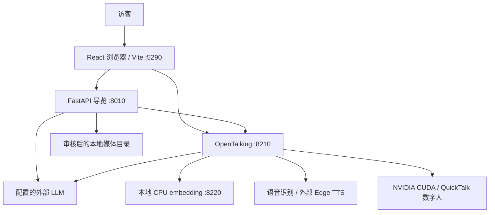
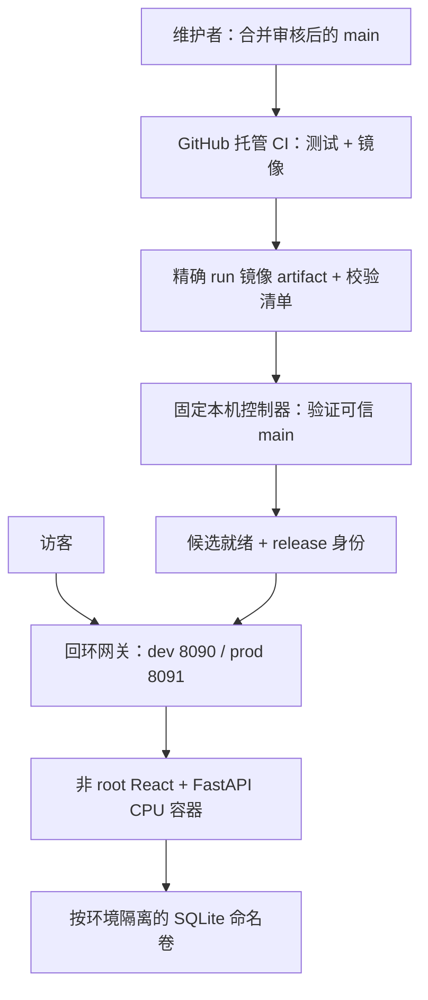

# 架构与上下文

本页是辅助中文译文，以[英文原文](../en/architecture.md)为准。

## 总览与证据索引

浏览器协调业务 API 与 OpenTalking 的交互；GPU 数字人渲染是完整本机体验的依赖之一。

[E1 启动器](../../tools/linux_dev.py)、[E2 API](../../src/exhibition_guide/main.py)、[E3 配置](../../config/example.toml)和 [E4 代理](../../frontend/vite.config.ts)是实现参考。

## 边界

`/guide` 代理到 FastAPI，`/opentalking` 代理到 OpenTalking；默认监听均为回环地址，不是公开部署。

导览服务负责回答验证、访客/轮次身份、上下文、导览规划和审核媒体访问。

OpenTalking 负责检索及数字人/语音传输；适配器从被忽略的本地配置转发已启用的 LLM 与 embedding 设置。

React 协调语音采集、播放和动态舞台，正常布局变化期间保持同一个 video/RTC 会话活动。

## 数据与配置

`config/example.toml` 默认关闭 LLM、embedding 和媒体，密钥与知识库 ID 留空，并提供通用数字人/声音默认值。

`config/local.toml` 和 `config/opentalking.env` 为被忽略的本地文件；下载权重、运行数据库和缓存不得进入提交。

原有 GPU 导览对话/游览状态仍保存在内存中；OpenTalking 可以在 `data/opentalking` 下使用自己的 SQLite 和知识存储。

CPU 样例应用是 `demo.py` 中独立的 FastAPI 工厂，在同一源提供 React 资源和 `/api`；会话、问题和反馈存入 `GUIDE_DEMO_DB` 指定的真实 SQLite 数据库。

不透明 HttpOnly 访客 cookie 选择哈希后的会话记录；所有历史和反馈查询都按会话隔离，request ID 让重试保持幂等。

CPU 模式对打包的原创虚构展品进行确定性检索，无需 GPU、外部凭据或 LLM 调用。

## 基线与后续上下文

课程文档以公开 `main` 的 `4e81d9d` 为产品起点，其通用功能从 `ruika` 的 `a523fa1` 同步，见[基线记录](tracker.md#baseline-record)。

CPU 核心、业务持久化和容器部署在 #12 实现；[验证记录](verification.md)区分实际结果与源码已有能力。

关联可观测性和告警驱动运维仍属于[产品规格](product-spec.md#planned-scope)中的计划。

## 容器与部署边界

控制器独立于 Actions，只接受固定仓库、`ci.yml`、成功的 `push` 事件和 `main` 分支；PR 使用托管 CI，不会获得主机执行权限。

候选共享对应环境的持久卷，必须兼容 schema；就绪失败保持旧网关路由不变，切换后的失败会恢复旧路由。

dev 和 prod 的 cookie、网络、卷分别隔离；晋级与回滚保留业务数据，并写入 GitHub Deployment 状态。

网关与应用以非 root 身份运行，根文件系统只读并移除 capabilities；控制器仍需要主机 Docker 权限，其固定安装需独立于镜像发布审核。
