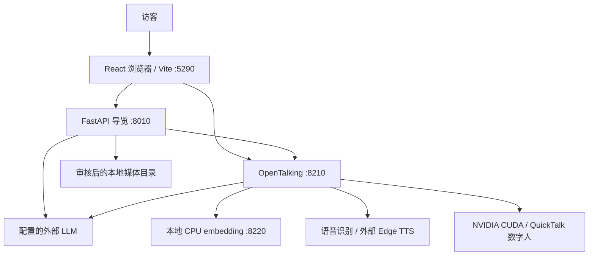

# 架构与上下文

本页是辅助中文译文，以[英文原文](../en/architecture.md)为准。

## 总览与证据索引

浏览器协调业务 API 与 OpenTalking 的交互；GPU 数字人渲染是完整本机体验的依赖之一。

[E1 启动器](../../tools/linux_dev.py)、[E2 API](../../src/exhibition_guide/main.py)、[E3 配置](../../config/example.toml)和 [E4 代理](../../frontend/vite.config.ts)是实现参考。

## 边界

`/guide` 代理到 FastAPI，`/opentalking` 代理到 OpenTalking；默认监听均为回环地址，不是公开部署。

导览服务负责回答验证、访客/轮次身份、上下文、导览规划和审核媒体访问。

OpenTalking 负责检索及数字人/语音传输；适配器从被忽略的本地配置转发已启用的 LLM 与 embedding 设置。

React 协调语音采集、播放和动态舞台，正常布局变化期间保持同一个 video/RTC 会话活动。

## 数据与配置

`config/example.toml` 默认关闭 LLM、embedding 和媒体，密钥与知识库 ID 留空，并提供通用数字人/声音默认值。

`config/local.toml` 和 `config/opentalking.env` 为被忽略的本地文件；下载权重、运行数据库和缓存不得进入提交。

导览对话/游览状态保存在内存中；OpenTalking 可以在 `data/opentalking` 下使用自己的 SQLite 和知识存储。

课程要求的面向访客业务持久化流程仍待完成，仅存在上游运行 SQLite 文件不能满足该要求。

## 基线与后续上下文

课程文档以公开 `main` 的 `4e81d9d` 为产品起点，其通用功能从 `ruika` 的 `a523fa1` 同步，见[基线记录](tracker.md#baseline-record)。

独立可运行的 CPU 核心、业务持久化、容器交付和生产运维仍属于[产品规格](product-spec.md#planned-scope)中的计划。
