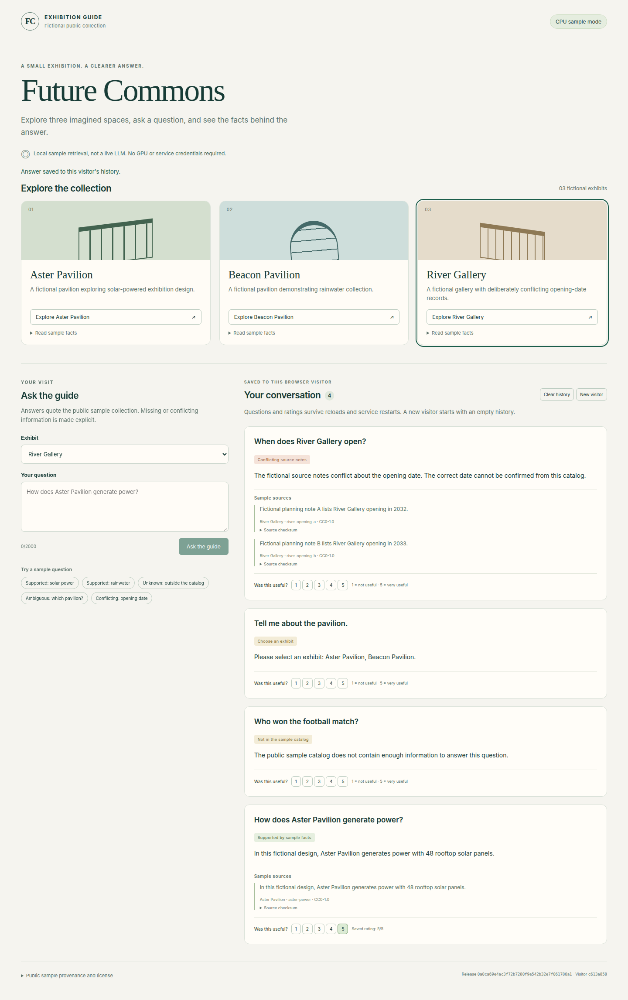

<a id="verification-and-release-evidence"></a>

# 验证与发布证据

本页是辅助中文译文，以[英文原文](../en/verification.md)为准。

<a id="overview-and-evidence-index"></a>

## 总览与证据索引

[#12](https://github.com/Joey-Z-G-W/AI-Enterprise-Exhibition/issues/12) 覆盖持久化 CPU 样例和路线图阶段 2–4，在独立 worktree 从 main `f9943c9` 开始。

[E1 验收标准](https://github.com/Joey-Z-G-W/AI-Enterprise-Exhibition/issues/12)、[E2 角色活动](tracker.md#current-role-activity)、[E3 测试命令](testing.md)和 [E4 CI workflow](../../.github/workflows/ci.yml)是审计入口。

实现 A 通过 [PR #13](https://github.com/Joey-Z-G-W/AI-Enterprise-Exhibition/pull/13) 合并为 `0a0ca69e4ac3f72b7280f9e542b32e7f061786a1`，文件树与独立审核的 `23179cc` 相同。

其[可信 main CI](https://github.com/Joey-Z-G-W/AI-Enterprise-Exhibition/actions/runs/42385984934)已成功；[合并前独立验收](https://github.com/Joey-Z-G-W/AI-Enterprise-Exhibition/issues/12#issuecomment-6708934862)明确区分已完成的源码/本机检查与后续发布操作。

<a id="current-delivery-checks"></a>

## 当前交付检查

测试重整后，[E5 `f4d8732` 的 main CI](https://github.com/Joey-Z-G-W/AI-Enterprise-Exhibition/actions/runs/42441943726) 于 2026 年 11 月 8 日通过。

| 已执行检查 | 证据与范围 |
| --- | --- |
| Python 回归 | [CI 作业日志](https://github.com/Joey-Z-G-W/AI-Enterprise-Exhibition/actions/runs/42441943726/job/128612836437)记录 124 项通过、1 项跳过、6 项未选入。跳过项需要两个发布产物及已授权的 Docker 环境。未选入的用例包括 4 项 embedding 系统测试及 2 项真实环境验收测试。 |
| 浏览器回归 | 同一作业通过浏览器集成测试、两条导览 E2E 及 CPU 演示浏览器流程。 |
| 最新 Docker 验证 | 同一作业通过 Compose 启动、Compose 环境下的浏览器流程及容器重建后的 SQLite 持久化检查。 |
| 精确 Compose 启动 | 托管 CI 从干净检出执行文档中的 `docker compose up --build --wait`，并验证真实重建后 SQLite 记录保留。 |
| 真实本机 Docker | [独立 QA](https://github.com/Joey-Z-G-W/AI-Enterprise-Exhibition/issues/12#issuecomment-6708934862)在 8092 端口使用单独批准的 QA 镜像，验证真实 Chrome cookie/会话/问题/引用/评分在 Docker 重启和同一命名卷重建后均保留。 |
| 隔离与运行边界 | QA 验证不同访客拒绝访问、已清空的历史正文、存储型 XSS 处理、非 root/只读容器，以及无关容器身份/镜像/配置保持不变。 |
| 验证失败阻止交付 | [失败 PR run](https://github.com/Joey-Z-G-W/AI-Enterprise-Exhibition/actions/runs/42382556438)未发布可部署镜像；真实控制器部署尝试被拒绝，未改变容器或路由。 |
| 可信 main 构建 | [实现 A main CI](https://github.com/Joey-Z-G-W/AI-Enterprise-Exhibition/actions/runs/42385984934)已针对上面的精确合并提交成功完成。 |
| 自动 dev 部署 | [Deployment 7623123912](https://api.github.com/repos/Joey-Z-G-W/AI-Enterprise-Exhibition/deployments/7623123912/statuses)已在回环端口 8090 成功，版本为 `0a0ca69e4ac3f72b7280f9e542b32e7f061786a1`；控制器在 main CI 完成前已处于运行状态。 |
| 人工生产晋级 | [Deployment 7623145538](https://api.github.com/repos/Joey-Z-G-W/AI-Enterprise-Exhibition/deployments/7623145538/statuses)已在回环端口 8091 成功，对应相同的实现 A 提交与 main CI run。 |

自动 dev 部署使用 main CI run `42385984934` 的已验证镜像 `sha256:51ea7b584be5e66daa6649a9ae5d3164dea863e9ee73cbda19fa9210a53522de`，对外健康接口版本与已部署提交一致。

双发布部署测试使用独立运行回执，不计作标准 CI 套件中已经执行的项目。

首次本机镜像仓库 EOF 是构建网络故障，不是测试通过；托管环境干净检出的 Compose 验收及后续真实本机容器检查提供已执行证据。

<a id="local-sample-demonstration"></a>

## 本机样例演示

这张未编辑截图来自生产端口 8091 上的独立真实 Chrome 验收，当时提供的版本为实现 A `0a0ca69e4ac3f72b7280f9e542b32e7f061786a1`。

截图展示原创虚构展品、有依据/未知/歧义/冲突四类响应、来源引用，以及已保存的访客反馈 5/5；不包含企业语料或凭据。



浏览器流程还验证了刷新保留、独立访客、跨访客反馈拒绝、重试冲突、清历史、新访客和手机布局；仅凭截图不能证明容器重启或回滚。

<a id="release-acceptance-and-publication"></a>

## 发布验收与公开结果

[#12 发布回执](https://github.com/Joey-Z-G-W/AI-Enterprise-Exhibition/issues/12)记录发布身份、自动 dev 部署、人工生产晋级、双发布回滚、坏候选下记录保留检查，以及最终 main 发布与独立验收。

请查看回执中实际链接的 run/deployment 结果；仅有源码、截图或合并前 QA 结论，不能证明这些运行结果。

最终部署版本、CI 结果及晋级/回滚验收持续记录在该回执中。

本次选择本机 Docker，端口只监听回环地址，并非公网托管应用。

<a id="current-localization-checks"></a>

## 当前双语检查

英文 README/AGENTS 和八份 `docs/en/` 页面保持权威，`docs/ch/` 保留完整对应中文版本。

交付更新必须保持双向链接、相同命令块、英文原始 Markdown 无中文字符或 CJK 标点，并继续忽略任务证据。

独立 QA 必须检查最终 diff 和两套语言内容，不能只引用历史语言迁移基线。

<a id="historical-evidence"></a>

## 历史证据

测试重整前，[实现 A 的最终 PR CI](https://github.com/Joey-Z-G-W/AI-Enterprise-Exhibition/actions/runs/42385501939)记录 402 项 Python 通过和 6 项可选跳过。

[#8 迁移 QA](https://github.com/Joey-Z-G-W/AI-Enterprise-Exhibition/issues/8#issuecomment-6707409190)在基线 `4e81d9d` 报告 366 个 Python 通过和五个可选 skip；这些仍是历史结果。

历史 [#10 本地 QA](https://github.com/Joey-Z-G-W/AI-Enterprise-Exhibition/issues/10#issuecomment-6707585830)检查十份文档、65 个链接/锚点、20 个忽略探针和产品文件未变；其[最终发布验收](https://github.com/Joey-Z-G-W/AI-Enterprise-Exhibition/issues/10#issuecomment-6707633096)与本次运行任务分开。

[#11](https://github.com/Joey-Z-G-W/AI-Enterprise-Exhibition/issues/11)确立英文主文档和完整中文译文，没有执行新的 CPU/Docker 交付路径。

<a id="recheck-commands"></a>

## 复查命令

```bash
git diff --check
bash -n tools/course_verify.sh tools/course_runner.sh
python3 -m py_compile tools/course_deploy.py tools/course_proxy.py
./tools/course_verify.sh
```

完整验证命令需要已安装的 Python/Node 依赖和 Google Chrome；主机专用发布验收还需要两个真实 main CI artifact、GitHub 权限和 Docker 访问，见[测试](testing.md#cpu-and-deployment-acceptance)。
