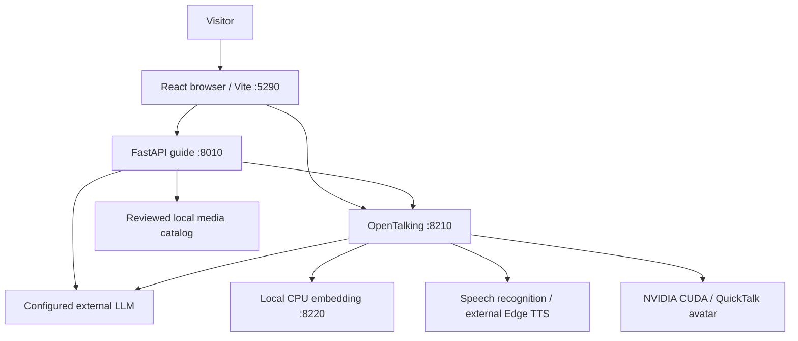

# Architecture and context

## Overview and evidence index

A browser orchestrates interaction with the business API and OpenTalking; GPU avatar rendering is one dependency of the full local experience.

[E1 Launcher](../../../../tools/linux_dev.py), [E2 API](../../../../src/exhibition_guide/main.py), [E3 Configuration](../../../../config/example.toml) and [E4 Proxy](../../../../frontend/vite.config.ts) are the implementation references.

## Boundaries

`/guide` proxies to FastAPI and `/opentalking` proxies to OpenTalking; all default listeners are loopback and are not a public deployment.

The guide owns answer validation, visitor/turn identity, context, tour planning and reviewed media access.

OpenTalking owns retrieval and avatar/voice transport; the adapter forwards enabled LLM and embedding settings from ignored local configuration.

React coordinates voice capture, playback and the adaptive stage, while a single video/RTC session remains active across normal layout changes.

## Data and configuration

`config/example.toml` disables LLM, embedding and media by default, leaves keys and the knowledge-base ID empty, and exposes generic avatar/voice defaults.

`config/local.toml` and `config/opentalking.env` are local and ignored; downloaded weights, runtime databases and caches must stay outside commits.

Guide conversation/tour state is in memory, while OpenTalking may use its own SQLite and knowledge storage under `data/opentalking`.

The course requirement for a persistent visitor-facing business flow remains pending; the presence of an upstream runtime SQLite file does not satisfy it by itself.

## Baseline and future context

The course documentation starts from public `main` at `4e81d9d`, whose generic features were synchronized from `ruika` at `a523fa1`; see [the baseline record](tracker.md#baseline-record).

A separately runnable CPU core, business persistence, container delivery and production operations remain planned in the [product specification](20261107-课程项目-展厅AI导览高分交付分批规划-spec.md#planned-scope).
