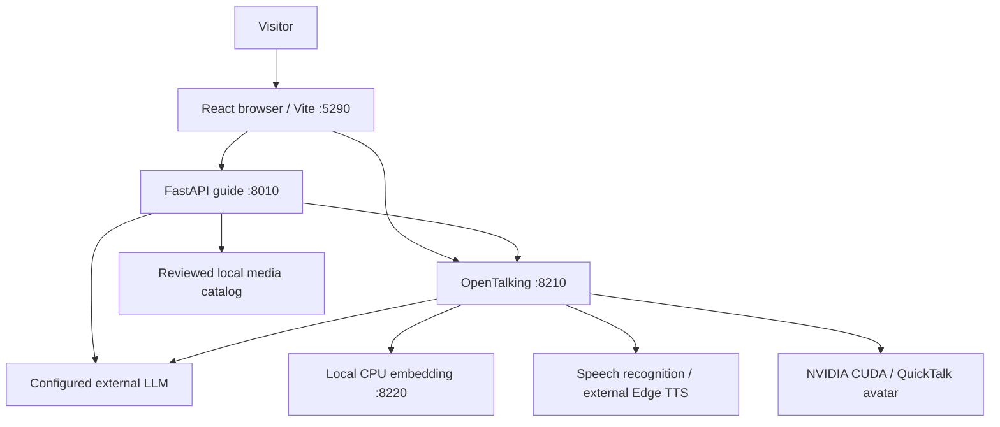
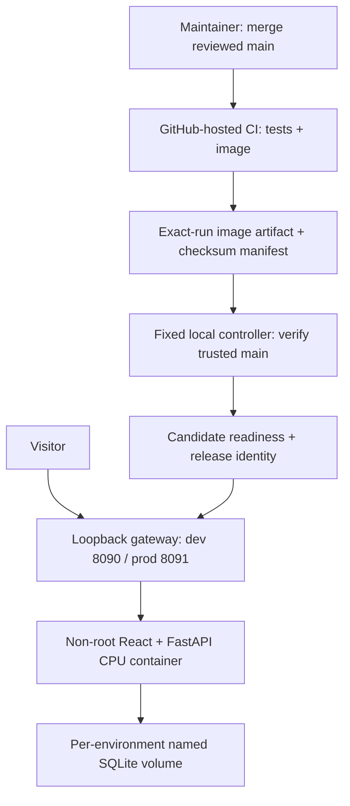

# Architecture and context

English is authoritative.

[Chinese translation](../ch/architecture.md)

## Overview and evidence index

A browser orchestrates interaction with the business API and OpenTalking; GPU avatar rendering is one dependency of the full local experience.

[E1 Launcher](../../tools/linux_dev.py), [E2 API](../../src/exhibition_guide/main.py), [E3 Configuration](../../config/example.toml) and [E4 Proxy](../../frontend/vite.config.ts) are the implementation references.

## Boundaries

`/guide` proxies to FastAPI and `/opentalking` proxies to OpenTalking; all default listeners are loopback and are not a public deployment.

The guide owns answer validation, visitor/turn identity, context, tour planning and reviewed media access.

OpenTalking owns retrieval and avatar/voice transport; the adapter forwards enabled LLM and embedding settings from ignored local configuration.

React coordinates voice capture, playback and the adaptive stage, while a single video/RTC session remains active across normal layout changes.

## Data and configuration

`config/example.toml` disables LLM, embedding and media by default, leaves keys and the knowledge-base ID empty, and exposes generic avatar/voice defaults.

`config/local.toml` and `config/opentalking.env` are local and ignored; downloaded weights, runtime databases and caches must stay outside commits.

The original GPU guide conversation/tour state remains in memory, while OpenTalking may use its own SQLite and knowledge storage under `data/opentalking`.

The CPU sample app is a separate FastAPI factory in `demo.py`, serving React assets and `/api` on one origin; sessions, questions and feedback live in a real SQLite database at `GUIDE_DEMO_DB`.

Opaque HttpOnly visitor cookies select hashed session records; every history and feedback query is scoped to that session, and request IDs make retries idempotent.

The CPU mode uses deterministic retrieval over packaged original fictional exhibits, without GPU, external credentials or LLM calls.

## Baseline and future context

The course documentation starts from public `main` at `4e81d9d`, whose generic features were synchronized from `ruika` at `a523fa1`; see [the baseline record](tracker.md#baseline-record).

The CPU core, business persistence and container deployment are implemented in #12; executed results remain separate from source availability in [verification](verification.md).

Correlated observability and alert-driven operations remain planned in the [product specification](product-spec.md#planned-scope).

## Container and deployment boundary

The controller runs outside Actions and accepts only the fixed repository, `ci.yml`, successful `push` event and `main` branch; pull requests use hosted CI and never receive host execution.

A candidate shares its environment's persistent volume and must be schema-compatible; failed readiness leaves the old gateway route unchanged, while post-switch failure restores it.

Dev and prod have separate cookies, networks and volumes; promotion and rollback retain business data and write GitHub Deployment statuses.

The gateway and app run without root, with a read-only root filesystem and dropped capabilities; the controller still requires host Docker privileges, so review its fixed installation separately from image releases.
