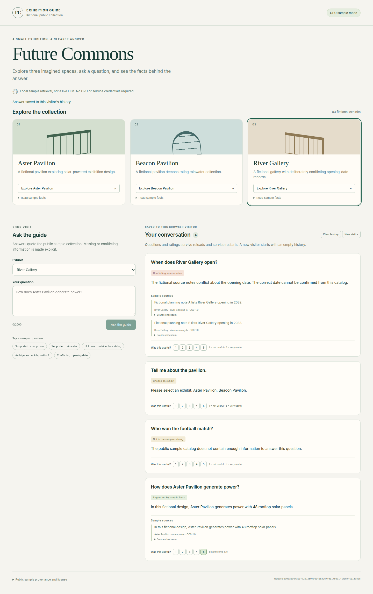

# Verification and release evidence

English is authoritative.

[Chinese translation](../ch/verification.md)

## Overview and evidence index

[#12](https://github.com/Joey-Z-G-W/AI-Enterprise-Exhibition/issues/12) covers persistent CPU samples and roadmap stages 2-4, starting from main `f9943c9` in an isolated worktree.

[E1 Acceptance criteria](https://github.com/Joey-Z-G-W/AI-Enterprise-Exhibition/issues/12), [E2 Role activity](tracker.md#current-role-activity), [E3 Test commands](testing.md) and [E4 CI workflow](../../.github/workflows/ci.yml) are the audit entry points.

Implementation A was merged through [PR #13](https://github.com/Joey-Z-G-W/AI-Enterprise-Exhibition/pull/13) as `0a0ca69e4ac3f72b7280f9e542b32e7f061786a1`, with the same tree independently reviewed at `23179cc`.

Its [trusted-main CI run](https://github.com/Joey-Z-G-W/AI-Enterprise-Exhibition/actions/runs/42385984934) succeeded; the [independent pre-merge acceptance](https://github.com/Joey-Z-G-W/AI-Enterprise-Exhibition/issues/12#issuecomment-6708934862) separates completed source/local checks from later release operations.

## Current delivery checks

[E5 Main CI for `f4d8732`](https://github.com/Joey-Z-G-W/AI-Enterprise-Exhibition/actions/runs/42441943726) passed on November 8, 2026 after the test suite was reorganized.

| Executed check | Evidence and scope |
| --- | --- |
| Python regression | [CI job log](https://github.com/Joey-Z-G-W/AI-Enterprise-Exhibition/actions/runs/42441943726/job/128612836437) reports 124 passed, 1 skipped and 6 deselected. The skipped test requires two release artifacts and an authorized Docker target. The deselected cases are four embedding system tests and two live acceptance tests. |
| Browser regression | The same job passed browser integration, both guide E2E scenarios and the CPU demo browser journey. |
| Latest Docker verification | The same job passed Compose startup, the browser journey against Compose and SQLite persistence after container recreation. |
| Exact Compose startup | Hosted CI ran the documented `docker compose up --build --wait` from a clean checkout and verified actual recreation with retained SQLite records. |
| Actual local Docker | [Independent QA](https://github.com/Joey-Z-G-W/AI-Enterprise-Exhibition/issues/12#issuecomment-6708934862) verified the real Chrome cookie/session/question/citations/rating through both Docker restart and recreation on the same named volume, using a separately approved QA image on port 8092. |
| Isolation and runtime boundaries | QA verified different-visitor rejection, cleared payloads, stored-XSS handling, non-root/read-only containers and unchanged unrelated container identities/images/configurations. |
| Validation blocks delivery | [Failed PR run](https://github.com/Joey-Z-G-W/AI-Enterprise-Exhibition/actions/runs/42382556438) did not publish a deployable image; an actual controller attempt rejected it without changing containers or routes. |
| Trusted-main build | [Implementation A main CI](https://github.com/Joey-Z-G-W/AI-Enterprise-Exhibition/actions/runs/42385984934) completed successfully for the exact merged commit above. |
| Automatic dev deployment | [Deployment 7623123912](https://api.github.com/repos/Joey-Z-G-W/AI-Enterprise-Exhibition/deployments/7623123912/statuses) succeeded on loopback port 8090 with release `0a0ca69e4ac3f72b7280f9e542b32e7f061786a1`; the controller was already active before main CI completed. |
| Manual production promotion | [Deployment 7623145538](https://api.github.com/repos/Joey-Z-G-W/AI-Enterprise-Exhibition/deployments/7623145538/statuses) succeeded on loopback port 8091 for the same implementation A commit and main CI run. |

The automatic dev deployment used verified image `sha256:51ea7b584be5e66daa6649a9ae5d3164dea863e9ee73cbda19fa9210a53522de` from main CI run `42385984934`, and the served health release matched the deployed commit.

The two-release deployment test has its own operational receipt rather than being counted as executed in the standard CI suite.

The initial local registry EOF was a build-network failure, not a passing test; hosted clean-checkout Compose acceptance and later actual local container checks provide the executed evidence.

## Local sample demonstration

This unedited screenshot was captured during independent real-Chrome acceptance on production port 8091, serving implementation A `0a0ca69e4ac3f72b7280f9e542b32e7f061786a1`.

It shows the original fictional collection, supported/unknown/ambiguous/conflicting responses, source citations and saved visitor feedback of 5/5; it contains no enterprise corpus or credentials.



The browser journey also verified reload retention, isolated visitors, rejected cross-visitor feedback, retry conflicts, clear history, new visitor and mobile layout; this screenshot alone does not prove container restart or rollback.

## Release acceptance and publication

The [#12 release receipt](https://github.com/Joey-Z-G-W/AI-Enterprise-Exhibition/issues/12) records release identities, automatic dev deployment, manual production promotion, two-release rollback and failed-candidate retention checks, plus final main publication and independent acceptance.

Read the actual linked run/deployment results in that receipt; source files, a screenshot or the pre-merge QA result alone do not establish those operational outcomes.

The final deployed revision, CI result and promotion/rollback acceptance are maintained in that receipt.

The selected deployment is local Docker on loopback-only ports, not a publicly hosted application.

## Current localization checks

English README/AGENTS and eight `docs/en/` pages remain authoritative, with a complete corresponding Chinese set under `docs/ch/`.

The delivery update must preserve reciprocal links, exact command blocks, no Chinese characters or CJK punctuation in raw English Markdown, and ignored task evidence.

Independent QA must check the final diff and both language sets, not only the earlier localization baseline.

## Historical evidence

The [implementation A final PR run](https://github.com/Joey-Z-G-W/AI-Enterprise-Exhibition/actions/runs/42385501939) recorded 402 Python passes and six optional skips before the test reorganization.

The [#8 migration QA](https://github.com/Joey-Z-G-W/AI-Enterprise-Exhibition/issues/8#issuecomment-6707409190) reported 366 Python passes and five optional skips at baseline `4e81d9d`; those results remain historical.

Historical [#10 local QA](https://github.com/Joey-Z-G-W/AI-Enterprise-Exhibition/issues/10#issuecomment-6707585830) checked ten documents, 65 links/anchors, 20 ignore probes and unchanged product files; its [final publication acceptance](https://github.com/Joey-Z-G-W/AI-Enterprise-Exhibition/issues/10#issuecomment-6707633096) is separate from this runtime task.

[#11](https://github.com/Joey-Z-G-W/AI-Enterprise-Exhibition/issues/11) established English-primary documentation and complete Chinese translations; it did not execute the new CPU/Docker delivery path.

## Recheck commands

```bash
git diff --check
bash -n tools/course_verify.sh tools/course_runner.sh
python3 -m py_compile tools/course_deploy.py tools/course_proxy.py
./tools/course_verify.sh
```

The complete verification command requires installed Python/Node dependencies and Google Chrome; host-specific release acceptance additionally requires two actual main CI artifacts, GitHub permissions and Docker access as described in [testing](testing.md#cpu-and-deployment-acceptance).
